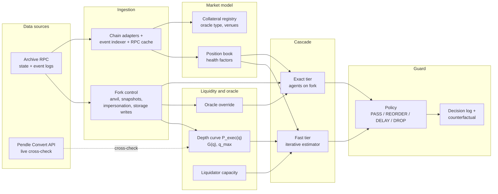

# Measurement and Mitigation of Illiquidity in Collateral-Based Lending in DeFi

**Undergraduate capstone.** Status as of 2026-10-26 (LAPEG v0 measured end to end; web app built).
Next milestone: **Review 2 (Nov 2 or 3, 2026)**: further implementation, an extended literature survey and an architecture/block diagram.

| Track | Question | Code | Status |
|---|---|---|---|
| **Measurement** | How much collateral can one liquidation sell profitably ($q_{max}$), and what price shock puts more than that up for sale ($\Delta^*$)? | [`pendle_ladder_all.py`](pendle_ladder_all.py), [`layer2_borrowers.py`](layer2_borrowers.py) | Done for 3 markets (Oct 18 and 19); daily snapshots running |
| **Mitigation: LAPEG** | Can a guard that simulates pending transactions on a mainnet fork, where a block builder sits, stop transactions that trigger liquidations the market cannot absorb? | [`lapeg/`](lapeg/) | Phases 0 to 2 done; Phases 3 to 5 at v0 (design, fast tier, guard v0), run on the Phase 2 data; web app built |

**Contents**
1. [Overview](#1-overview)
2. [Terminology](#2-terminology)
3. [Markets studied](#3-markets-studied)
4. [Metrics](#4-metrics)
5. [Measurement, Layer 1: liquidation capacity](#5-measurement-layer-1-liquidation-capacity)
6. [Measurement, Layer 2: borrowers under a price shock](#6-measurement-layer-2-borrowers-under-a-price-shock)
7. [Daily snapshots](#7-daily-snapshots)
8. [Mitigation: LAPEG](#8-mitigation-lapeg)
9. [Roadmap](#9-roadmap)
10. [Repository layout](#10-repository-layout)

---

## 1. Overview

Lending markets assume that a bad loan can always be liquidated: a liquidator repays the debt, takes the collateral at a discount, and sells it. That assumption fails if the collateral cannot be sold in size without moving its price too much.

The project studies three Morpho Blue markets that accept **Pendle Principal Tokens (PTs)** as collateral. A PT is redeemable for 1 unit of its underlying asset at maturity, so before maturity it trades at a discount. Its liquidity is mostly one Pendle AMM pool plus whatever DEX liquidity exists for the underlying asset.

- **Measurement** quantifies the problem. Layer 1 measures how large a single liquidation sale can be before it stops paying ($q_{max}$). Layer 2 measures which borrowers become liquidatable as prices fall, and the shock $\Delta^*$ at which their collateral exceeds $q_{max}$.
- **Mitigation** builds LAPEG, a liquidity-aware pre-execution guard. For each candidate block it simulates the pending transactions on a fork of real chain state, predicts whether they push illiquid positions into liquidations the market cannot absorb, and then passes, reorders, delays or drops them.

**Measurement results at a glance**

| Market | $q_{max}$ (Oct 19) | What limits it | $\Delta^*$ | What breaks at $\Delta^*$ |
|---|---|---|---|---|
| PT-reUSD-10DEC2026 | $12.8M to $13.0M | Aggregator leg (cliff) | **2.04%** | Largest borrower plus 9 others exceed $q_{max}$ |
| PT-USD3-17DEC2026 | $3.95M to $4.00M | Pendle AMM | **3.58%** | 10 borrowers exceed $q_{max}$; the largest is 2.2x $q_{max}$ alone |
| PT-sUSDS-26NOV2026 | No slippage crossing | Pendle refuses above about $17.5M | **15.56%** | Collateral exceeds Pendle's refusal limit |

**Findings from the LAPEG groundwork** (details in [`lapeg/docs/assumptions.md`](lapeg/docs/assumptions.md))

- **The three oracles work differently.** PT-reUSD's oracle follows the Pendle market price (a 15-minute TWAP), so a price-feedback spiral is possible there. PT-USD3's is a fixed 30%/yr discount that ignores the market. PT-sUSDS's currently uses a fixed 13%/yr discount.
- **The Aug 25, 2026 liquidations are real and hit the target market.** In the PT-reUSD-10DEC2026/USDC market, 16 liquidations repaid $35.19M within 55 blocks (04:37 to 04:48 UTC), with no bad debt. The largest single liquidation repaid $13.01M, close to the market's $q_{max}$.
- **Historical state is available for free.** The public endpoint `eth.drpc.org` serves archive state, so the fork can start at Aug 25.
- **Quoted depth is not the same as executable depth.** Pendle's aggregator routes execute on a fork up to $2.56M, and at $1M the output matches the quote to within $0.46. At $3.9M, OKX's quoted route reverts on mainnet too (`ARM: Insufficient liquidity`): the aggregator priced liquidity a venue did not have. Layer 1's quote-based $q_{max}$ may therefore overstate what liquidators can actually sell (Phase 2 measures this size by size).
- **One liquidator did almost all of Aug 25.** One address repaid 97.2% of the $35.19M (10 of 16 liquidations); liquidations came 1 to 7 blocks apart.

## 2. Terminology

The LAPEG spec and the measurement scripts name the same quantities differently.

| Measurement name | Spec name | Relationship |
|---|---|---|
| $S_o(q) = 1 - P_{exec}(q)/P_{oracle}$ | $G(q) = (P_{oracle} - P_{exec}(q))/P_{oracle}$ | Identical |
| $q^*$ | $q_{max}$(bonus) | Identical for slippage. $q_{max}$ is also capped by sizes the route refuses (PT-sUSDS) |
| Profit threshold $0.3(1-LLTV)$ | Profitability condition | The spec subtracts gas; the measurement threshold does not, so $q^*$ is an upper bound |
| Layer 2 shock model | Phase 4 fast tier | Layer 2 is the one-step version; the fast tier adds the feedback loop (liquidations, then price impact, then new health factors, repeated) |

This README uses $q_{max}$ and $S_o$ from here on.

## 3. Markets studied

All three borrow USDC on Ethereum. Parameters are from `results/morpho_pt_markets_clean.csv` (2026-10-18). They were re-checked against the Morpho API on 2026-10-19 and on-chain (`idToMarketParams`) on 2026-10-22.

| Market | Maturity | LLTV | LIF | Threshold | Borrowed (Oct 18) | Oracle price (Oct 18) | How the oracle prices the PT |
|---|---|---|---|---|---|---|---|
| **PT-reUSD-10DEC2026** (LAPEG v0 target) | 2026-12-10 | 0.915 | 1.0262 | 2.55% | $116.95M | 0.983591 | Lower of a 15-min Pendle TWAP and a 6%/yr linear discount. The TWAP binds, so it **follows the market** |
| PT-USD3-17DEC2026 | 2026-12-17 | 0.86 | 1.0438 | 4.20% | $23.42M | 0.950918 | 30%/yr linear discount. **Ignores the market** |
| PT-sUSDS-26NOV2026 | 2026-11-26 | 0.915 | 1.0262 | 2.55% | $16.15M | 0.986213 | Primary/backup switch. The primary is the lower of a 15-min TWAP and a 13%/yr linear discount; the **linear discount binds** |

Market IDs, tokens and oracle addresses are in [`lapeg/data/discovered/markets.json`](lapeg/data/discovered/markets.json); full oracle trees are in [`oracles.json`](lapeg/data/discovered/oracles.json). None of the three markets has a pre-liquidation contract, so standard Morpho liquidation is the only path.

PT-reUSD is the LAPEG v0 target: its oracle follows the market (so the spec's checks apply cleanly), its $q_{max}$ is measured, and the Aug 25 event happened in this exact market.

## 4. Metrics

Unless stated otherwise, "PT" amounts are token counts and "$" amounts are valued at the oracle price.

### 4.1 Background terms

| Term | Meaning | Role in this project |
|---|---|---|
| Oracle price $P_o$ | The price Morpho uses to value collateral (USDC per PT) | Decides who is liquidatable and how much collateral a liquidator receives |
| LTV | Debt divided by collateral value at $P_o$ | A borrower's leverage |
| LLTV | The LTV at which a position becomes liquidatable (0.915 or 0.86 here) | The liquidation line |
| Health factor $HF$ | $LLTV / LTV$ | Above 1 is safe; below 1 the position can be liquidated |
| LIF | Liquidation incentive factor: collateral a liquidator receives per $1 of debt repaid | The liquidator's margin before selling |

How a liquidation works: once a borrower's $HF$ falls below 1, anyone can repay some of their debt and receive $LIF$ times that amount in collateral, valued at the oracle price. The liquidator then usually sells that collateral for the debt asset (USDC) to lock in the bonus. **Every metric below is about whether that last step, the sale, still works.**

### 4.2 $S_o(q)$, spec $G(q)$: slippage against the oracle

$$S_o(q) = 1 - \frac{P_{exec}(q)}{P_o}$$

$P_{exec}(q)$ is the average price actually received when selling PT worth $q$ (at oracle value) into USDC.

- **What it measures:** how far below the oracle price the liquidator actually sells. It combines price impact from the sale's size and any standing gap between the oracle and the market.
- **Why against the oracle, not the market price:** the liquidator's bonus is fixed in oracle terms, so profit depends on the sale price relative to the oracle.
- **How to read it:**
  - $S_o > 0$: the sale gets less than the oracle price, so part of the bonus is lost.
  - $S_o < 0$: the market pays *more* than the oracle. This happens when the oracle sits below the market by design (the linear-discount oracles). Example: a $100k PT-USD3 sale executes at 0.9827 against an oracle of 0.9509, so $S_o = -3.34\%$.
- **Depends on size:** $S_o$ grows as $q$ grows. The list of $S_o$ values at increasing sizes is the "ladder" of Layer 1, and the spec's "depth curve".

### 4.3 Profit threshold $0.3(1-LLTV)$

Morpho Blue sets the bonus from the LLTV:

$$LIF = \min\left(1.15,\ \frac{1}{0.3\,LLTV + 0.7}\right)$$

A liquidator repaying $r$ USDC receives $r \cdot LIF / P_o$ PT and sells it for $r \cdot LIF \cdot P_{exec} / P_o$ USDC. That beats the $r$ they paid iff

$$LIF \cdot \frac{P_{exec}}{P_o} > 1 \iff S_o(q) < 1 - \frac{1}{LIF} = 0.3\,(1 - LLTV)$$

The last equality holds whenever the 1.15 cap does not bind (LLTV above about 0.565, true for all three markets).

| LLTV | LIF (bonus) | Threshold: maximum tolerable $S_o$ | Markets |
|---|---|---|---|
| 0.915 | 1.0262 (+2.62%) | 2.55% | reUSD, sUSDS |
| 0.86 | 1.0438 (+4.38%) | 4.20% | USD3 |

- **Intuition:** the bonus is the liquidator's cushion. Slippage beyond the threshold turns the liquidation into a loss, so a rational liquidator stops.
- **Worked example (reUSD):** repaying $1M earns $1.0262M of PT at oracle value. Selling at $S_o = 0.57\%$ (a $13.8M sale) returns about $1.020M, a profit of about $20k. Selling at $S_o = 2.92\%$ (a $14.0M sale) returns about $0.996M, a loss of about $4k.
- **Gross of costs:** gas and the cost of capital are ignored, so $q_{max}$ here is an upper bound on the profitable size.

### 4.4 $q_{max}$: liquidation capacity

$$q_{max} = \text{the largest sale size that executes and keeps } S_o(q) < 0.3(1-LLTV)$$

- **What it measures:** the largest amount of collateral that can be liquidated **in one sale** and still make money.
- **Units:** dollars at oracle value, or PT tokens ($q_{max}/P_o$). Layer 2 uses PT, because a price shock changes the dollar value of the same tokens without changing how many must be sold.
- **Reported as a range:** the search brackets the crossing to within 2%.
- **Refusals count:** if Pendle refuses a sale before slippage reaches the threshold (PT-sUSDS), the refusal size is the capacity.

| Supporting metric | Meaning | How to read it |
|---|---|---|
| Internal impact | Price impact inside the Pendle AMM | High: the Pendle pool is the bottleneck (USD3) |
| External impact | Price impact in the aggregator swap from the underlying to USDC | High: DEX liquidity for the underlying asset is the bottleneck (reUSD) |
| Refusal (`MarketProportionTooHigh`) | Pendle's AMM caps the PT share of its pool, so the API will not quote a sale that pushes past it | A hard size limit, independent of price |

### 4.5 Shock metrics (Layer 2, and the start of the cascade model)

| Metric | Formula | What it measures |
|---|---|---|
| Shock $\Delta$ | Oracle (and market) price falls to $P_o(1-\Delta)$ | The size of the price drop being tested |
| Trigger shock $\Delta_i$ | $1 - \dfrac{LTV_i}{LLTV} = 1 - \dfrac{1}{HF_i}$ | Borrower $i$'s distance to liquidation |
| Collateral for sale $Q(\Delta)$ | $\sum_{\Delta_i \le \Delta} c_i$ (total) or $\sum_{\Delta_i \le \Delta} \min\left(c_i, \frac{b_i \cdot LIF}{P_o(1-\Delta)}\right)$ (seizable) | How much PT liquidators must sell after a shock of $\Delta$ |
| Break point $\Delta^*$ | Smallest $\Delta_i$ with $S_o(Q(\Delta_i)) \ge 0.3(1-LLTV)$ or a refusal | The smallest shock after which the backlog cannot be cleared in one profitable sale |

- **$\Delta_i$ example:** PT-USD3's largest borrower has $HF = 1.0387$, so $\Delta_i = 1 - 1/1.0387 = 3.73\%$.
- **Total vs seizable $Q$:** just past the trigger, a liquidator can seize $LLTV \cdot LIF$ of a position: 93.9% of the collateral at LLTV 0.915 and 89.8% at LLTV 0.86.
- **Reading $\Delta^*$:** below it, every liquidation that becomes possible can be completed profitably. Above it, underwater positions wait and bad-debt risk grows. A **small** $\Delta^*$ means a fragile market.

| Concentration metric | How to read it |
|---|---|
| Largest position / $q_{max}$ | Above 1x: the largest borrower cannot be liquidated in one profitable sale even alone |
| Top-5 share | High: a few liquidations decide the outcome |
| Collateral / refusal limit | Above 1x: liquidating every borrower would need a sale Pendle refuses outright |

### 4.6 How big is a shock of $\Delta$ for a PT?

A PT's price drops either because **the underlying asset depegs** by $\Delta$, or because **its implied yield jumps**. With price $P$ and $d$ days to maturity (simple yield), a drop of $\Delta$ needs

$$\Delta y = \frac{1}{P} \cdot \frac{\Delta}{1-\Delta} \cdot \frac{365}{d}$$

| Market | $\Delta^*$ | Days to maturity (Oct 19) | Same as an underlying depeg of | Same as an implied-yield jump of |
|---|---|---|---|---|
| PT-reUSD-10DEC2026 | 2.04% | 52 | 2.04% | +14.9 percentage points |
| PT-USD3-17DEC2026 | 3.58% | 59 | 3.58% | +24.1 percentage points |
| PT-sUSDS-26NOV2026 | 15.56% | 38 | 15.56% | +180 percentage points |

Which shocks move the **oracle** depends on its design (section 3): only PT-reUSD's oracle follows the market today. None of the three uses an asset-to-USD price feed in its main path, so a depeg of the underlying would not move it directly (still to confirm: which token each Pendle SY treats as its asset).

---

## 5. Measurement, Layer 1: liquidation capacity

> **Question:** how large can one liquidation sale be before $S_o(q)$ reaches the threshold?
> **Inputs:** market parameters CSV, Pendle Convert API quotes. **Output:** $q_{max}$ per market.

### 5.1 Method

Script: [`pendle_ladder_all.py`](pendle_ladder_all.py).

1. Load each market from the CSV (or read `decimals()` and oracle `price()` on-chain with `--live`).
2. Request a PT to USDC quote from Pendle's Convert API (`/core/v3/sdk/1/convert`, aggregators enabled), keeping the best route returned.
3. **Bracket:** start at $100k and double until a quote is unprofitable or refused, capped at 1.5x outstanding borrow.
4. **Bisect** between the last good and first bad size until the interval is within 2%.
5. Record every quote, including Pendle's split of price impact into the **internal** leg (Pendle AMM) and **external** leg (aggregator swap of the underlying into USDC).

Quotes only: no transactions, no wallet, no keys. Calls are paced by the API's rate-limit headers (free tier, 200 CU/min). These are **live preview quotes**: they cannot be replayed at a past block, which is why LAPEG executes swaps on a fork instead (section 8.4).

### 5.2 Results (2026-10-18 07:21 UTC)

| Market | $q_{max}$ range | % of borrow | $S_o$ at $100k | Bottleneck |
|---|---|---|---|---|
| PT-reUSD-10DEC2026 | $13.80M to $14.00M | 11.8% to 12.0% | +0.03% | Aggregator leg (sudden cliff) |
| PT-USD3-17DEC2026 | $4.10M to $4.15M | 17.5% to 17.7% | -3.34% | Pendle AMM |
| PT-sUSDS-26NOV2026 | No slippage crossing | n/a | -0.83% | Pendle refuses sales above about $17.7M |


*$S_o(q)$ in % on a symlog axis. Dashed lines: thresholds of 2.55% and 4.20%.*

**PT-reUSD-10DEC2026: a cliff in the aggregator leg**

| $q$ | $6.4M | $12.8M | $13.8M | $14.0M | $16.0M | $19.2M | $25.6M |
|---|---|---|---|---|---|---|---|
| $S_o$ | 0.33% | 0.54% | 0.57% | **2.92%** | 11.4% | 27.5% | 46.0% |
| USDC out | $6.38M | $12.73M | $13.72M | $13.59M | $14.18M | $13.92M | $13.84M |

- Slippage stays below 0.6% up to $13.8M, then jumps past the threshold within $200k.
- At $14.0M, 2.55 of the 2.95 points of price impact are in the external (aggregator) leg, so the binding limit is USDC liquidity for the underlying asset, not the Pendle pool.
- **USDC output tops out around $13.9M to $14.2M whatever the size.** The route behaves like a hard cap on USDC depth, not a gradual slope.

**PT-USD3-17DEC2026: a gradual Pendle AMM limit**

| $q$ | $1.6M | $3.2M | $4.0M | $4.10M | $4.15M | $4.8M | $6.4M |
|---|---|---|---|---|---|---|---|
| $S_o$ | -2.39% | +1.94% | 3.99% | 4.19% | **4.28%** | 5.35% | 7.50% |

- From $1.6M upward, all of the price impact is internal (the Pendle AMM).
- The oracle (a fixed 30%/yr discount) sits **3.2% below** the small-trade execution price. That gap works as a buffer: without it, $q_{max}$ would be smaller.

**PT-sUSDS-26NOV2026: a refusal limit, not a slippage limit**

| $q$ | $12.8M | $15.66M | $17.08M | $17.62M | $17.80M | $18.51M | $24.2M |
|---|---|---|---|---|---|---|---|
| $S_o$ | -0.81% | -0.80% | -0.75% | -0.69% | refused | refused | refused |

- Slippage never comes close to the 2.55% threshold.
- Pendle refuses sales between **$17.62M and $17.80M** (17.87M to 18.05M PT) with `MarketProportionTooHigh`. A rerun at 07:25 UTC reproduced every quote to within about $5.

### 5.3 Second snapshot (2026-10-19 14:00 UTC, `--live`)

| Market | $q_{max}$ on Oct 18 | $q_{max}$ on Oct 19 | $q_{max}$ on Oct 19 (PT) |
|---|---|---|---|
| PT-reUSD-10DEC2026 | $13.80M to $14.00M | $12.80M to $13.00M | 13.01M to 13.21M |
| PT-USD3-17DEC2026 | $4.10M to $4.15M | $3.95M to $4.00M | 4.15M to 4.20M |
| PT-sUSDS-26NOV2026 (refusal) | $17.62M to $17.80M | $17.44M to $17.62M | 17.68M to 17.86M |

### 5.4 Verification and known issues

Confirmed against the Morpho API and on-chain: LLTV, collateral token, oracle address and decimals for all three markets; oracle scale exponents; LIF values, thresholds, $q_{max}$ brackets and bottleneck attributions.

| # | Issue | Effect | Status |
|---|---|---|---|
| 1 | `implied_apy_simple_pct` computes the discount rate $(1-P)\frac{365}{d}$, not a yield | Understates yields: reUSD 11.5% (not 11.3%), USD3 31.4% (not 29.9%), sUSDS 13.1% (not 12.9%) | Open: use $\left(\frac{1}{P}-1\right)\frac{365}{d}$ |
| 2 | The sUSDS summary row read like a slippage crossing | Misleading label | Fixed 2026-10-20: statuses are `refusal boundary`, `slippage crossing` or `refused even at the starting size` |
| 3 | Quotes use `slippage=0.5`, which Pendle reads as 50% | No effect on quoted amounts | Open: set to 0.01 |
| 4 | Borrow figures in the CSV are rounded and their source is not logged | Small effect on % of borrow | Superseded: LAPEG reads markets on-chain |
| 5 | The internal/external impact split relies on Pendle's response field names | The bottleneck attribution is unverified | Open: Phase 2 measures each leg on the fork |

### 5.5 Limitations

- **One sale, one route.** A real liquidator could split sales across blocks, use other venues, or hold the PT to maturity. (On Aug 25, the PT-reUSD liquidations were spread over 16 transactions in 16 different blocks.)
- **Gross of costs.** $S_o$ ignores gas and the cost of capital.
- **Snapshots, not a time series.** $q_{max}$ fell by 1% to 7% in one day, and the best route switched between OKX and KyberSwap from quote to quote. The daily snapshots (section 7) address this.

### 5.6 Files and reproduce

```
pendle_ladder_all.py                               quote ladder and q_max search
results/
  morpho_pt_markets_clean.csv                      market inputs (2026-10-18)
  ladder_all_2026-10-18T072153Z.csv                every quote, all markets
  qstar_summary_2026-10-18T072153Z.csv             q_max per market
  so_curves_2026-10-18T072153Z.png                 S_o curves
  ladder_all_2026-10-18T072539Z.csv                sUSDS rerun (reproducibility)
  ladder_all_2026-10-19T140033Z.csv                second snapshot (--live), used by Layer 2
  qstar_summary_2026-10-19T140033Z.csv
```

```bash
pip install -r requirements.txt
python pendle_ladder_all.py --data results/morpho_pt_markets_clean.csv --outdir results --live --plot
python pendle_ladder_all.py --data results/morpho_pt_markets_clean.csv --only PT-USD3-17DEC2026   # one market
python pendle_ladder_all.py --mock                                                               # offline test
```

Optional environment variables: `PENDLE_API_KEY`, `ETH_RPC_URL`.

---

## 6. Measurement, Layer 2: borrowers under a price shock

> **Question:** as prices fall, which borrowers become liquidatable, and at what shock $\Delta^*$ does the collateral to be sold exceed $q_{max}$?
> **Inputs:** Morpho GraphQL positions, live oracle price, Layer 1 ladder. **Output:** $\Delta^*$ per market.

### 6.1 Method

Script: [`layer2_borrowers.py`](layer2_borrowers.py). Read-only Morpho GraphQL and `eth_call` requests, plus live Pendle quotes with `--requote`.

1. **Positions:** every borrower's collateral $c_i$ (PT) and debt $b_i$ (USDC) from Morpho's `marketPositions` API.
2. **LTV at the live oracle price:** $LTV_i = b_i / (c_i P_o)$.
3. **Shock model** (section 4.5): the oracle and the market both fall to $P_o(1-\Delta)$, so $S_o$ in PT units is unchanged. Borrowers are sorted by $\Delta_i$ and $Q(\Delta)$ is accumulated.
4. **Link to Layer 1:** $S_o(Q(\Delta))$ is interpolated from the newest ladder over `pt_sold`. Sizes at or above the first refusal fail; sizes beyond the ladder are re-quoted live.
5. **Break point:** $\Delta^* = \min\{\Delta_i : S_o(Q(\Delta_i)) \ge 0.3(1-LLTV) \text{ or refused}\}$.

LAPEG Phase 1 replaces step 1 with a position book rebuilt from on-chain events, with health factors that match Morpho's own code exactly (section 8.2).

### 6.2 Results (positions 2026-10-19 14:56 UTC, ladder 2026-10-19 14:00 UTC)

| Market | Borrowers | $\Delta^*$ | Liquidatable at $\Delta^*$ | $Q$ at $\Delta^*$ (total / seizable) | What breaks |
|---|---|---|---|---|---|
| PT-reUSD-10DEC2026 | 243 | **2.04%** | 10 | 23.27M / 21.88M PT | Slippage: $S_o$ = 38% / 34% |
| PT-USD3-17DEC2026 | 223 | **3.58%** | 10 | 5.52M / 5.02M PT | Slippage: $S_o$ = 6.0% / 5.3% |
| PT-sUSDS-26NOV2026 | 14 | **15.56%** | 13 | 18.93M / 18.80M PT | Pendle refuses the sale |

| Market | $q_{max}$ (PT) | Largest position (PT) | Largest / $q_{max}$ | Largest position's trigger | Top-5 share |
|---|---|---|---|---|---|
| PT-reUSD-10DEC2026 | 13.01M | 13.07M | 1.00x | 2.04% | 32.0% |
| PT-USD3-17DEC2026 | 4.15M | 9.23M | **2.22x** | 3.73% | 49.7% |
| PT-sUSDS-26NOV2026 | 17.68M (refusal) | 6.35M | 0.36x | 7.19% | **93.6%** |

- **reUSD: one borrower decides the outcome.** Up to a 2.04% shock, 9 small positions (10.19M PT) can be liquidated at under 0.5% slippage. At 2.04% the largest borrower (13.07M PT, about $q_{max}$ alone) joins them, and the combined 23.27M PT hits the aggregator cliff.
- **USD3: liquidation fails before the largest borrower is reached.** At 3.58%, 10 borrowers holding 5.52M PT already exceed $q_{max}$. The largest position is 2.2x $q_{max}$.
- **sUSDS: slippage never binds, the pool size does.** At 15.56% the 13th borrower pushes $Q$ past Pendle's refusal limit. Five borrowers hold 93.6% of the collateral.

### 6.3 Verification

- **Positions are complete.** Summed debt matches each market's total exactly; summed collateral within 0.08%. reUSD differs by 3.8%: 5.81M PT held in 13 positions with no debt, which can never be liquidated.
- **LTVs are right.** $LLTV / LTV_i$ matches the API's health factor to within $3 \times 10^{-5}$.
- **Robust:** total vs seizable $Q$, and the Oct 18 vs Oct 19 ladder, give the same $\Delta^*$ in every market.

### 6.4 Limitations

- **The shock moves the oracle and the market together.** This fits PT-reUSD, whose oracle follows the Pendle TWAP (with up to a 15-minute lag). It does not fit PT-USD3, whose oracle ignores the market: there, a market crash triggers no liquidations, and liquidations that interest or time trigger become unprofitable instead. PT-sUSDS is in between: its oracle follows the market only below the 13%/yr discount curve.
- **Stress case.** All liquidatable borrowers are liquidated in full, in one sale, with no top-ups or repayments first.
- **One step.** No feedback from liquidation sales back to the oracle. Adding that loop is the Phase 4 fast tier.

### 6.5 Files and reproduce

```
layer2_borrowers.py                                positions, shock model, Delta*
results/
  positions_2026-10-19T145646Z.csv                 every borrower: collateral, debt, LTV, Delta_i
  shock_curve_2026-10-19T145646Z.csv               Q(Delta) and S_o(Q) per market
  delta_star_2026-10-19T145646Z.csv                Delta*, largest position, top-5 share, refusal check
```

```bash
python layer2_borrowers.py                                     # all markets, newest ladder per market
python layer2_borrowers.py --only PT-USD3-17DEC2026 --requote  # one market, live quotes beyond the ladder
```

---

## 7. Daily snapshots

A GitHub Actions workflow ([`.github/workflows/daily-snapshot.yml`](.github/workflows/daily-snapshot.yml)) runs both measurement layers every day at 14:17 UTC and commits the results to `results/daily/`. It builds a time series of $q_{max}$ and $\Delta^*$ as each PT approaches maturity (Nov 26, Dec 10 and Dec 17). Live quotes cannot be collected after the fact.

- Layer 1 runs with `--live`; Layer 2 with `--requote` and shortened wallet addresses.
- If one market fails, the others are still recorded.
- Manual run or stop: GitHub, Actions, "daily snapshot".

---

## 8. Mitigation: LAPEG

LAPEG (Liquidity-Aware Pre-Execution Guard) sits where a sequencer or block builder would. For each candidate block it simulates the pending transactions on a fork of real chain state, predicts whether they push positions backed by illiquid collateral into liquidations the market cannot absorb at the oracle price, and chooses an action:

- **PASS:** include as-is.
- **REORDER:** find an ordering of the pending transactions that avoids or shrinks the cascade.
- **DELAY / DROP:** hold the offending transaction to a later block, or exclude it (DROP is off by default).

Every decision is logged with a counterfactual: what the market would have looked like without the guard.

**Research contribution.** Generic simulate-and-drop guards already exist (the spec cites Phylax Credible Layer; not yet verified). The contribution here is (1) the **liquidity-aware predicate**: the size-dependent gap $G(q)$, liquidator capacity and cascade amplification, and (2) the **reorder search**, as opposed to drop-only.

Code, setup and commands: [`lapeg/README.md`](lapeg/README.md). Findings and assumptions: [`lapeg/docs/assumptions.md`](lapeg/docs/assumptions.md). Interfaces: [`lapeg/docs/interfaces.md`](lapeg/docs/interfaces.md).

### 8.1 Architecture (draft block diagram)



### 8.2 Phases, v0 scope and status

The full spec has eight phases. For Review 2 the target is a thin vertical slice, **LAPEG v0**, on PT-reUSD-10DEC2026; the rest is presented as designed future work.

| Phase | What it builds | v0 scope | Status |
|---|---|---|---|
| 0 | Fork lifecycle, snapshots, impersonation, balances, storage writes, RPC cache | Full | **Done** (34 pytest + 1 forge test; acceptance passes at pinned block 26267600) |
| 1 | Market model: position book from events, health factors matched to Morpho's own views | Lite: one market | **Done** (271 borrowers at block 26267600; health factors match Morpho exactly; Morpho's own `liquidate` agrees for all) |
| 2 | Depth curve on the fork, $G(q)$, oracle override, $q_{max}$, liquidator capacity, illiquidity metric | Full for one market | **Done** (all 9 acceptance checks pass). $q_{max}$ between \$13.19M and \$13.40M; $\Delta^* = 2.11\%$. Results in section 8.6 |
| 3 | Agents, calibration, Aug 25 replay (the validation gate), $C^*$ search | Design; event discovery and calibration | **Design written** ([`phase3_design.md`](lapeg/docs/phase3_design.md)); Aug 25 located; liquidator concentration and sizes calibrated; latency calibration to do |
| 4 | Cascade predictor: exact tier and fast tier | Fast tier only | **Fast tier run on the Phase 2 data** (TWAP lag, latency, feedback loop). Its liquidatable sets match Morpho's at all 11 shocks |
| 5 | Guard and policy, reorder search | Guard v0: PASS or DELAY on pending transactions, with a counterfactual log | **Guard v0 run on the Phase 2 data** (DELAY instead of DROP, which stays off by default as the spec requires) |
| 6, 7 | Evaluation harness, baselines; other protocols and RWA collateral | Design only | **Design written** ([`design_phases4_7.md`](lapeg/docs/design_phases4_7.md)) |

**Cut order if time runs short** (cut from the bottom): guard v0 becomes a design slide; the fast-tier cascade runs on the API-derived depth curve instead of the fork; Phase 2 runs on the API curve only.

**Review framing:** guard v0 demonstrates the architecture. It is not evidence that the guard works, because the simulator is validated only against the existing API results until Phase 3 compares it with Aug 25. The guard is not tuned against an unvalidated simulator.

### 8.3 What the groundwork established

| Item | Result | Record |
|---|---|---|
| Archive access | Public `ethereum-rpc.publicnode.com` is not archive. The free `eth.drpc.org` serves archive state; anvil forks at Aug 25 work. Decision: use drpc for now | `archive_check_*.json` |
| Morpho Blue and markets | Address discovered via the Morpho API and verified on-chain; `idToMarketParams` matches the dataset for all three markets | `morpho_blue.json`, `markets.json` |
| Oracle sources | See section 3. Unverified contracts were identified by matching bytecode against verified instances; the evidence is stored per contract | `oracles.json` |
| Aug 25, 2026 event | 58 `Liquidate` events in 13 markets between Aug 24 and 27. PT-reUSD-10DEC2026/USDC (the target market): 16 liquidations, 13 borrowers, 3 liquidators, 35.19M USDC repaid, 37.60M PT seized, no bad debt, 04:37 to 04:48 UTC. PT-reUSD-10DEC2026/USDT: 17 liquidations, 0.96M USDT | `aug25_event.json` |

All records are in [`lapeg/data/discovered/`](lapeg/data/discovered/), each with the query used.

### 8.4 Known conflicts between the spec and the measurements

| # | Conflict | Resolution |
|---|---|---|
| 1 | The Phase 2 sanity check ($G \approx 0$ at tiny $q$) | Holds only where the oracle follows the market. Resolved by reading the oracles: applies to PT-reUSD; the linear-discount oracles of PT-USD3 and PT-sUSDS sit below the market by design |
| 2 | API quotes cannot be replayed at a past block | **Resolved, with a finding.** Measurement runs in stages: each stage quotes a batch and forks the block right after, so quotes and state match. Up to $q_{max}$ the fork's output matches the quote within 0.1% (acceptance check). Some larger quoted routes revert, and a real-node cross-check shows they revert on mainnet too (OKX at \$3.84M, KyberSwap from 15.5M PT): quotes can overstate executable depth |
| 3 | $q_{max}$ must cover refusals | Defined as the largest size that both executes and stays under the bonus; a reverted swap on the fork counts as a failure |
| 4 | Gas is in the spec's profitability condition but not in $S_o$ | **Resolved.** Gas is measured on the fork (1.9M to 2.9M per sale) and priced with Chainlink ETH/USD: about $0.23 at the current base fee, negligible. A 100 gwei stress scenario is also reported |
| 5 | Replaying router calldata on the fork | **Resolved.** Both KyberSwap and OKX routes replay on the fork, including Pendle limit-order fills. A Pendle-only route (no aggregator) is also measured |

### 8.5 Unverified claims in the spec

| Claim | Status |
|---|---|
| Aug 25, 2026 PT/YT-reUSD liquidation cascade | **Located on-chain** in the target market (section 8.3). Not yet checked: the YT side, what triggered it, and liquidity at the time |
| Oct 2025 USDe depeg window | Not yet searched |
| Mar 2026 Aave CAPO misconfiguration | Not yet searched |
| Phylax Credible Layer (prior art) | Not yet verified |
| arXiv 2212.07306, "Toxic Liquidation Spirals" (baseline) | Not yet verified |

---

### 8.6 Results: Phases 2, 4 and 5 (PT-reUSD-10DEC2026)

**Phase 2** (grid at block 26269480, zoom stages at 26269857 and 26269961, end-to-end at 26277620; all 9
acceptance checks pass):

| Quantity | Value |
|---|---|
| $q_{max}$ (bonus and gas; same under a 100 gwei stress fee) | 13.37M to 13.59M PT, about \$13.19M to \$13.40M, 10.7% of the \$123.1M borrowed |
| $G$ along the curve | 0.025% at \$0.1M, 0.40% at \$8.65M, 1.08% at \$13.19M, then 3.58% at \$13.40M (a cliff), 8.2% at \$14.1M, 31.5% at \$19.5M |
| Break point $\Delta^*$ | 2.11%: 11 borrowers liquidatable, 22.1M PT seizable against about 13.4M PT of capacity |
| Backlog ratio $B(\Delta)$ | 0.03 at 1%, 0.66 at 2%, 1.72 at 2.5%, 4.3 at 5%, 6.9 at 10%, 9.8 at 20% |
| End to end | A real `liquidate` of the largest borrower at $\Delta^*$, then a real sale of the 12.28M PT seized. The profit is overstated because the override moves only the oracle, not the market |
| Gas | about \$0.16 to \$0.53 per sale at the measured base fee |

**Phases 4 and 5** (fast tier and guard v0 on the Phase 2 data, no market refill for one hour):

- The fast tier's liquidatable sets match Morpho's at all 11 shocks.
- A \$10M sale is the smallest that leaves stuck debt ($C^* \approx$ \$10M): 155 positions, \$94.8M.
- Guard v0 passes \$0.5M and \$5M sales and delays a \$20M sale, releasing it flagged after two delays (DROP off).
- **Caveat:** with no refill these are worst-case bounds. On Aug 25 this market cleared \$35.2M in about 11 minutes
  with no bad debt, so depth does refill. How fast is the main open question, and Phase 3's calibration has to
  measure it.

### 8.7 Web app

A local web app that explains the finding to a reader without a DeFi background and lets them try it. It is a
React front end (`lapeg/web/`) over a small Python API (`lapeg/lapeg/app/api.py`) that calls the same code the
experiments use.

| Section | What the reader does |
|---|---|
| The finding | Drags a "sounding line" along the measured depth curve, drawn as a seabed profile, to see the loss at any sale size |
| What if? | Picks a price drop or a large sale and a refill speed; all 272 loans are simulated for the next hour and shown as dots (safe, liquidated in time, stuck, loss) |
| The guard | Sets the size of a waiting sale; guard v0 answers "let it through" or "hold it", with both outcomes side by side |
| Live lab | Starts a live copy of the chain, lowers the price feed, skips time, sells, liquidates loans with Morpho's own `liquidate`, and undoes steps |

Every jargon term opens a plain-language definition. Nothing leaves the local fork: accounts are impersonated, with
no wallet, keys or funds.

```bash
cd lapeg
pip install -e ".[app]"
cd web && npm install && npm run build && cd ..   # once
python -m lapeg.app                                # opens http://127.0.0.1:8000
```

## 9. Roadmap

**Review 2 (Nov 2 or 3, 2026)**

- [x] Measurement: Layer 1 ($q_{max}$) and Layer 2 ($\Delta^*$) for three markets, fact-checked
- [x] Daily measurement snapshots until maturity (from 2026-10-20)
- [x] LAPEG groundwork: archive access, interfaces, oracle sources, Aug 25 event scan
- [x] LAPEG Phase 0: fork control and RPC cache, acceptance passing
- [x] LAPEG Phase 1 (lite): position book for PT-reUSD with health factors matched to Morpho within $10^{-9}$ (achieved: exact)
- [x] LAPEG Phase 2: depth curve and $G(q)$ on the fork, oracle override, $q_{max}$, API cross-check (section 8.6)
- [x] LAPEG Phase 3 (v0): design, event discovery, liquidator concentration and size calibration
- [x] LAPEG Phase 4 fast tier: cascade with feedback, run on the Phase 2 data
- [x] LAPEG guard v0: PASS or DELAY with a counterfactual log, run on the Phase 2 data
- [x] Web app for non-specialists, with a live lab (section 8.7)
- [x] Design for Phases 4 to 7
- [ ] Architecture/block diagram (draft in section 8.1)
- [ ] Extended literature survey (teammates)
- [ ] Slides

**After Review 2**

- [ ] Phase 3: liquidator calibration and the Aug 25 replay (the validation gate), $C^*$ search
- [ ] Phase 4 exact tier and the fast-vs-exact comparison
- [ ] Phase 5: reorder search, DELAY, full policy
- [ ] Phase 6: evaluation harness and baselines (lower LLTV, higher incentive, TWAP oracle, liquidity-aware supply cap, halting liquidations above an LTV)
- [ ] Phase 7: Aave v3 and Euler v2 adapters, RWA collateral

---

## 10. Repository layout

```
README.md                         this report
pendle_ladder_all.py              measurement, Layer 1
layer2_borrowers.py               measurement, Layer 2
requirements.txt                  measurement dependencies (pinned)
results/                          measurement inputs and outputs; results/daily/ from the workflow
.github/workflows/                daily snapshot workflow
lapeg/                            mitigation: LAPEG research prototype (own README, pyproject, tests)
lapeg/lapeg/app/                  web app API and live fork session
lapeg/web/                        web app front end (React)
```
